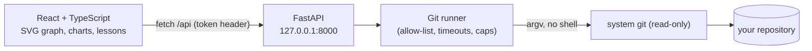

# BranchVerse

> Understand your repository. Explore its history.

BranchVerse is a local, **read-only** web app for exploring Git repositories visually — and for learning how
branching works. Open any repository on your machine to see its commit graph, branches, contributors, a
branching-strategy summary, and a "Time Machine" through its history. New to Git? The **Learn** section walks
through commits, branches, merges and the common branching strategies with small interactive graphs.

*Screenshots: add yours here after running the demo below.*

## Features

| | |
|---|---|
| **Commit graph** | Custom SVG graph with lanes, merge commits, root commits, branch/tag labels, pagination (100 at a time) and continuation markers |
| **Commit inspector** | Full metadata, parents (merge commits compare against the first parent, labelled), changed files, bounded text diffs |
| **Branch explorer** | Local/remote branches, ahead/behind vs upstream *or* the default branch (clearly labelled), highlight everything reachable from a branch |
| **Strategy** | Describes what the history looks like (trunk-based / feature-branch / GitFlow-like) with the evidence behind the label |
| **Analytics** | Unique commits, contributors, commits per week, additions/deletions per week, scope stated for every metric |
| **Time Machine** | Slide through HEAD's first-parent history; file lists and changes are read from Git objects — no checkout |
| **Learn** | Seven lessons with step-by-step illustrated graphs (clearly marked as invented examples) |

## Architecture



* **Python owns Git.** The browser never runs commands. All Git access goes through one runner
  (`backend/app/core/git_runner.py`) so security rules are applied everywhere.
* **React owns presentation.** Layout, graph rendering and charts live in the frontend; the backend returns
  structured, validated JSON.

### Graph algorithm

`frontend/src/lib/graphLayout.ts` takes commits in topological order (children first) and keeps a list of
*lanes*, each waiting for one commit SHA. A commit takes the left-most lane waiting for it (or opens a new
lane = branch tip); other lanes waiting for the same commit converge into it and are freed. Its first parent
continues in the same lane, extra parents (merges) reuse a lane already waiting for them or open a new one.
Lanes still open after the last loaded row are drawn as dashed continuations — never as false edges. Layout is
prefix-stable, so "Load more" does not move existing rows.

## Security model

BranchVerse is for **trusted local use, not public hosting**. Repositories are treated as untrusted input.

* Git is run with argument arrays (never a shell), from an allow-list of read-only subcommands.
* Hooks, `core.fsmonitor`, external diff, textconv and pagers are disabled; user/system Git config and inherited
  `GIT_*` variables are ignored; prompts and optional locks are off; pathspecs are literal.
* Revisions are never accepted from the client — only full 40-hex SHAs (verified to exist) or ref names that
  appear in the repository's own ref list. File paths must match a file actually changed by that commit.
* Timeouts and output caps on every subprocess; diffs are truncated at 200 KB.
* The API binds to `127.0.0.1`, validates `Host` (DNS-rebinding defence) and `Origin`, uses a restrictive CORS
  allow-list, and requires a per-process session token header on every data endpoint.
* The frontend renders all repository content as plain text (no `dangerouslySetInnerHTML`).

Because user Git config is ignored, repositories Git considers to have "unsafe ownership" are refused.

## Setup

Requirements: Git, Python 3.12+, Node 20+, pnpm.

```bash
# backend
cd backend
python -m venv .venv
.venv/Scripts/pip install -r requirements.txt      # macOS/Linux: .venv/bin/pip

# frontend
cd ../frontend
pnpm install
```

## Run

```bash
# terminal 1 — API (127.0.0.1:8000)
cd backend && .venv/Scripts/python -m uvicorn app.main:app --host 127.0.0.1 --port 8000

# terminal 2 — UI (http://127.0.0.1:5173, proxies /api to the backend)
cd frontend && pnpm dev
```

Open <http://127.0.0.1:5173> and enter the path of a local repository.

### Demo repository (no GitHub needed)

```bash
backend/.venv/Scripts/python fixtures/create_demo_repo.py     # prints the path
```

Creates a deterministic repo in your temp directory (3 authors, two merged feature branches, one unmerged
branch, a tag, added/modified/deleted files). It refuses to run inside an existing Git repository.

**90-second tour:** open the demo path → Commits (click a merge commit, check its parents, open a file diff) →
Branches (click `fix/typo` to highlight it) → Strategy → Analytics → Time Machine (drag backwards, then
*Return to present*) → Learn.

## Tests

```bash
cd backend  && .venv/Scripts/python -m pytest        # uses real temporary Git repositories
cd frontend && pnpm test -- --run && pnpm build
```

## Known limitations

* Loads 100 commits per page; very large histories are paged, not virtualised. Analytics scan at most the
  newest 50,000 commits (the UI says when this applies).
* Time Machine follows HEAD's first-parent history only — it does not reconstruct every branch's past state.
* Strategy detection is a heuristic over branch names and merge shape; squash-merge workflows look linear.
* SHA-1 repositories only (40-hex IDs). Submodules appear as single entries.
* One repository open at a time; nothing is persisted except a short list of recent paths in `localStorage`.

## Roadmap

Multiple saved repositories and side-by-side strategy comparison, interactive "sandbox" lessons with guided
exercises, tag/release timeline, bare-repo and worktree polish, SHA-256 support.
