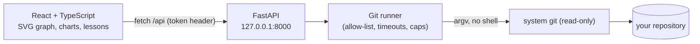

# BranchVerse

> Understand your repository. Explore its history.

BranchVerse is a local, **read-only** web app for exploring Git repositories visually — and for learning how
branching works. Open a repository on your machine — or paste a public GitHub link — to see its commit graph, branches, contributors, a
branching-strategy summary, and a "Time Machine" through its history. New to Git? The **Learn** section walks
through commits, branches, merges and the common branching strategies with small interactive graphs.

*Screenshots: add yours here after running the demo below.*

## Features

| | |
|---|---|
| **Commit graph** | Custom SVG graph with lanes, merge commits, root commits, branch/tag labels, pagination (100 at a time) and continuation markers |
| **Commit inspector** | Full metadata, parents (merge commits compare against the first parent, labelled), changed files, bounded text diffs |
| **Branch explorer** | Local/remote branches, ahead/behind vs upstream *or* the default branch (clearly labelled), highlight everything reachable from a branch |
| **Compare** | A pull-request-style view of any two branches: commits ahead/behind, files changed from the merge base, expandable diffs. Read-only — nothing is merged |
| **GitHub pull requests** | For repositories opened from GitHub, enter a PR number (`123`, `#123` or a PR link) to see its title, state, author, commits and diffs — including merged and closed PRs |
| **Strategy** | Describes what the history looks like (trunk-based / feature-branch / GitFlow-like) with the evidence behind the label |
| **Analytics** | Unique commits, contributors, commits per week, additions/deletions per week, scope stated for every metric |
| **Time Machine** | Slide through HEAD's first-parent history; file lists and changes are read from Git objects — no checkout |
| **Releases** | Tags as a release timeline: commits, contributors and days since the previous tag, newest 100 tags |
| **Learn** | Seven lessons with step-by-step illustrated graphs (clearly marked as invented examples) |

## Architecture



* **Python owns Git.** The browser never runs commands. All Git access goes through one runner
  (`backend/app/core/git_runner.py`) so security rules are applied everywhere.
* **React owns presentation.** Layout, graph rendering and charts live in the frontend; the backend returns
  structured, validated JSON.

### Graph algorithm

`frontend/src/lib/graphLayout.ts` takes commits in topological order (children first) and keeps a list of
*lanes*, each waiting for one commit SHA. A commit takes the left-most lane waiting for it (or opens a new
lane = branch tip); other lanes waiting for the same commit converge into it and are freed. Its first parent
continues in the same lane, extra parents (merges) reuse a lane already waiting for them or open a new one.
Lanes still open after the last loaded row are drawn as dashed continuations — never as false edges. Layout is
prefix-stable, so "Load more" does not move existing rows.

## Opening a GitHub repository

Paste `https://github.com/owner/repo` on the welcome screen. The backend downloads a temporary **blobless bare
clone** (all commits, branches, tags and file trees, but no file contents) into a cache folder under your temp
directory, then reads it like any other repository. File contents for a diff are fetched on demand. Copies older
than 24 hours are deleted at startup, and re-opening a repo replaces its earlier copy.

* Only `https://github.com/<owner>/<repo>` links are accepted; the clone URL is rebuilt from the validated owner
  and name, so nothing else from what you paste reaches Git.
* The download has a 3-minute timeout, a 750 MB disk cap, and only one runs at a time.
* Public repositories only — no credentials are used or stored.
* Line-change statistics are unavailable for these repositories (they need file contents).

**Pull requests by number.** GitHub exposes every PR as `refs/pull/N/head`. BranchVerse fetches just that ref
(blobless) into a private `refs/branchverse/pr/N`, then builds the same view as *Compare*. Title, state, author and
the PR's recorded base commit come from GitHub's public REST API (`api.github.com`, unauthenticated, 8 s timeout,
1 MB limit; the 60 requests/hour limit applies). If the API is unavailable the PR is compared with the default
branch and the UI says so. Merged and closed PRs use GitHub's recorded base commit, so their diff matches what was
reviewed rather than appearing empty.

## Security model

BranchVerse is for **trusted local use, not public hosting**. Repositories are treated as untrusted input.
Local repositories are read fully offline. The only network access is the GitHub download and PR fetch above
(Git over `https`, only for repositories inside the cache folder) plus one fixed `api.github.com` request per PR
lookup, built from a validated owner, repository and integer; its response is size-limited, type-checked and
shown as plain text, and redirects off `api.github.com` are refused.

* Git is run with argument arrays (never a shell), from an allow-list of read-only subcommands.
* Hooks, `core.fsmonitor`, external diff, textconv and pagers are disabled; user/system Git config and inherited
  `GIT_*` variables are ignored; prompts and optional locks are off; pathspecs are literal.
* Revisions are never accepted from the client — only full 40-hex SHAs (verified to exist) or ref names that
  appear in the repository's own ref list. File paths must match a file actually changed by that commit.
* Timeouts and output caps on every subprocess; diffs are truncated at 200 KB.
* The API binds to `127.0.0.1`, validates `Host` (DNS-rebinding defence) and `Origin`, uses a restrictive CORS
  allow-list, and requires a per-process session token header on every data endpoint.
* The frontend renders all repository content as plain text (no `dangerouslySetInnerHTML`).

Because user Git config is ignored, repositories Git considers to have "unsafe ownership" are refused.

## Setup

Requirements: Git, Python 3.12+, Node 20+, pnpm.

```bash
# backend
cd backend
python -m venv .venv
.venv/Scripts/pip install -r requirements.txt      # macOS/Linux: .venv/bin/pip

# frontend
cd ../frontend
pnpm install
```

## Run

```bash
# terminal 1 — API (127.0.0.1:8000)
cd backend && .venv/Scripts/python -m uvicorn app.main:app --host 127.0.0.1 --port 8000

# terminal 2 — UI (http://127.0.0.1:5173, proxies /api to the backend)
cd frontend && pnpm dev
```

Open <http://127.0.0.1:5173> and enter the path of a local repository.

### Demo repository (no GitHub needed)

```bash
backend/.venv/Scripts/python fixtures/create_demo_repo.py     # prints the path
```

Creates a deterministic repo in your temp directory (3 authors, two merged feature branches, one unmerged
branch, a tag, added/modified/deleted files). It refuses to run inside an existing Git repository.

**90-second tour:** open the demo path → Commits (click a merge commit, check its parents, open a file diff) →
Branches (click `fix/typo` to highlight it) → Strategy → Analytics → Time Machine (drag backwards, then
*Return to present*) → Learn.

## Tests

```bash
cd backend  && .venv/Scripts/python -m pytest        # uses real temporary Git repositories
cd frontend && pnpm test -- --run && pnpm build
```

## Performance

* **Streaming, not buffering:** analytics, file lists and line-change totals are read from Git as a stream, so
  memory stays proportional to the result, not the repository (peak Python memory was ≤ 8 MB on a synthetic
  5,000-commit, 40-branch repository).
* **Cached per repository state:** analytics, strategy, timeline and branch data are memoised and invalidated
  automatically when any ref or HEAD changes (a 2-second recheck window; reopening always re-checks).
* **One Git call for all branch comparisons** (Git ≥ 2.41; older Git falls back to parallel calls).
* **Virtualised commit graph:** only rows near the viewport are in the DOM, so very long histories scroll
  smoothly. Secondary views are lazy-loaded, API responses are gzip-compressed, and large diffs render 1,500
  lines at a time.

## Known limitations

* Loads 100 commits per page; very large histories are paged, not virtualised. Analytics scan at most the
  newest 50,000 commits (the UI says when this applies).
* Time Machine follows HEAD's first-parent history only — it does not reconstruct every branch's past state.
* Strategy detection is a heuristic over branch names and merge shape; squash-merge workflows look linear.
* SHA-1 repositories only (40-hex IDs). Submodules appear as single entries.
* GitHub downloads need Git's blobless-clone support (Git 2.19+) and a GitHub-reachable network; very large
  repositories can hit the time or size limit. PR details need the GitHub API (60 requests/hour unauthenticated).
* One repository open at a time; nothing is persisted except a short list of recent paths in `localStorage`.

## Roadmap

Optional GitHub token for higher API limits, multiple saved repositories and side-by-side strategy comparison, interactive "sandbox" lessons with guided
exercises, bare-repo and worktree polish, SHA-256 support.
